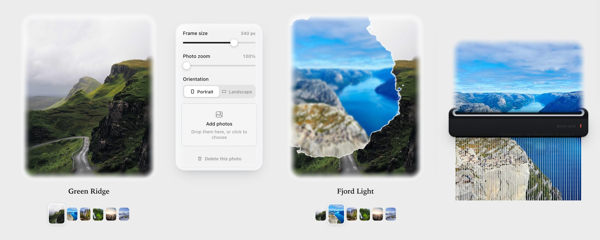

# UI Lab

Interface pieces built while learning front-end craft: motion, shaders, surfaces and the small physics that make an interface feel made. Each piece lives in its own folder as a self-contained page with no build step, and has its own README on how it works.

## Pieces

| Piece | What it is | Live |
| --- | --- | --- |
| [Boom Card](boom-card/) | A photo card. Photos switch with an ink bloom that spreads from your tap, the edges are feathered into the page, and deleting a photo feeds it through a desk shredder. WebGL, Canvas 2D, a Verlet strip simulation. | [Open](https://alexko0421.github.io/ui-lab/boom-card/) |



## Run them

From the root of this repository:

```bash
python3 -m http.server 8000
```

Then open http://localhost:8000 and pick a folder. Every piece is also live at https://alexko0421.github.io/ui-lab/.

## License

[MIT](LICENSE). Where a piece adapts someone else's open-source work, its notice is in the licence and the piece's README says what came from where.
